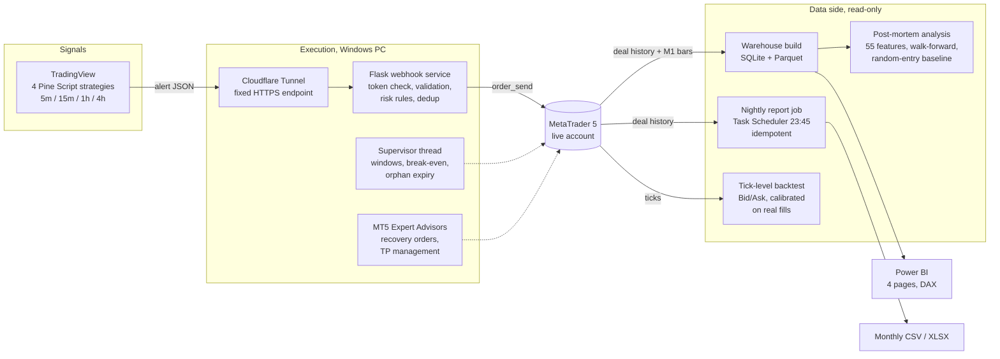
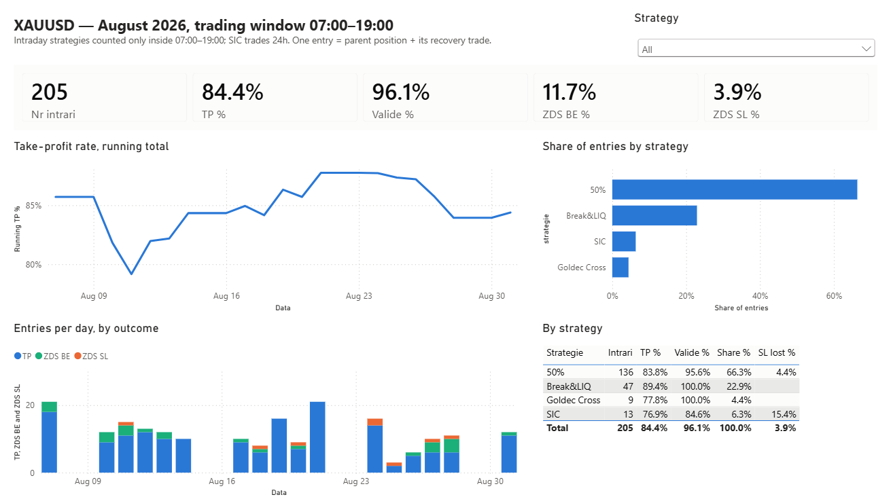
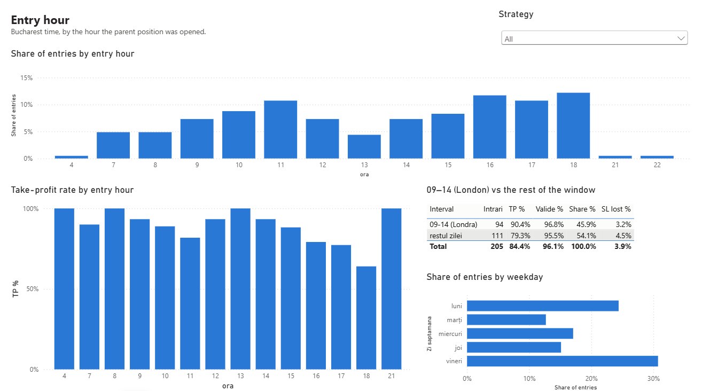
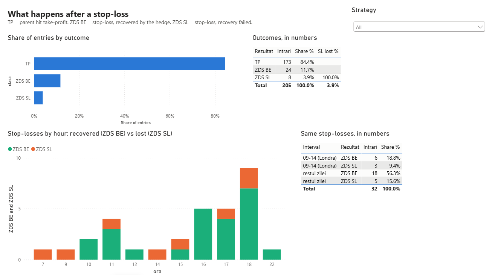
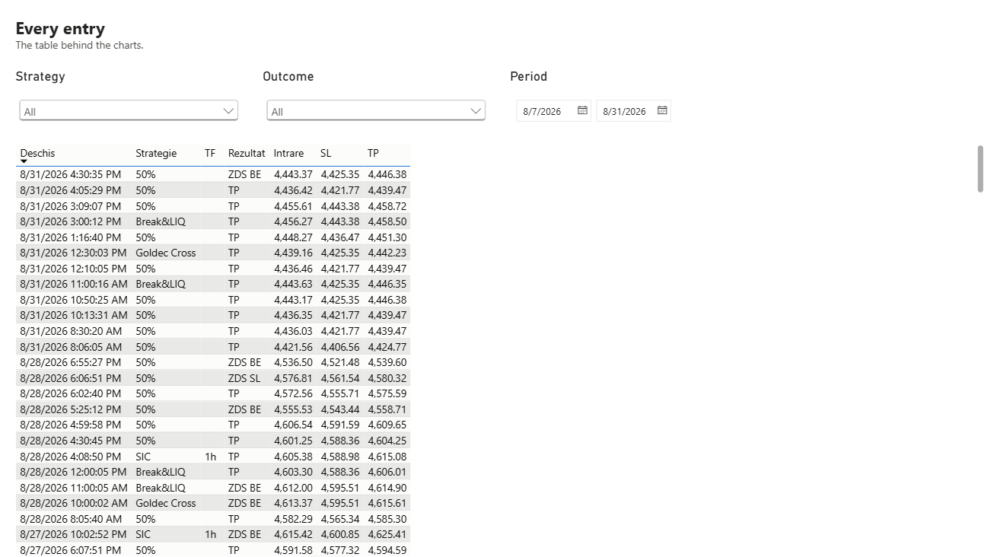

# XAUUSD Trading System & Data Pipeline

**An automated gold-trading system on a live account, plus the data pipeline that tells me whether it actually works.** TradingView signals become MetaTrader 5 orders automatically. Every night the real executions are pulled back out, linked, reported and loaded into a small warehouse that feeds Power BI.

> **Source code is private.** It trades a real account, so this repository only describes the system: what it does, how data moves through it, and what the data showed. Happy to walk through the code in an interview.

## What it does

- **Execution.** Four strategies run as Pine Script indicators on TradingView (one of them on four timeframes at once). When a setup fires, an alert with the entry, stop and target goes to a webhook. A Python service checks it and places the order in MetaTrader 5.
- **Risk rules on every order.** Minimum stop distance, maximum slippage, per-strategy trading windows, one open setup per strategy and timeframe, and a recovery order parked at the stop level of each position.
- **A supervisor that never sleeps.** A background thread cancels limit orders whose move already happened without them, moves stops to break-even, expires orphaned pending orders if the cancel signal never arrives, and tightens the exit on positions that stay open too long.
- **Reporting.** A scheduled job rebuilds the monthly execution report from the broker's history every night, in the exact layout the trader already used by hand.
- **Analysis.** A SQLite + Parquet warehouse and a Power BI report on top of it, plus a post-mortem study that asked the uncomfortable question: is there an edge at all?

## Architecture

**Execution and analysis are kept apart on purpose.** Nothing on the data side can place an order: the report job, the warehouse and the analysis only read history. The report job even checks that the terminal is already running before connecting, so a scheduled run can never start an unattended trading terminal.

## Power BI: August 2026, inside the trading windows

Same filter as the monthly report the trader works from: the three intraday strategies count only inside their 07:00–19:00 windows, SIC trades around the clock.

| | |
|---|---|
| Entries | **205** |
| Hit take-profit directly | **84.4%** |
| Stop-loss recovered to break-even | **11.7%** |
| Stop-loss lost | **3.9%** |
| Take-profit or recovered (“valid”) | **96.1%** |
| Take-profit rate, 09:00–14:00 (London) vs the rest of the window | **90.4%** vs **79.3%** |

| Overview | Entry hour |
|---|---|
|  |  |
| **What happens after a stop-loss** | **Every entry** |
|  |  |

The model: one fact table of entries (a parent position joined to its recovery trade), a calendar dimension, and DAX measures for hit rate, recovered and lost rates, share of entries and a running take-profit rate. Colours belong to the outcome, not the series order, so a take-profit is always blue on every page. The report is saved as a PBIP project (TMDL + PBIR), so it lives in git as text.

## Engineering problems worth mentioning

- **Linking positions without a key.** Most recovery trades carry the parent's ID in their comment; some come through a fallback path with no reference at all. Those are matched by time (within 120 s of the stop) and exit price, one-to-one, so two parents stopped out in the same second on the same level each get the right recovery. An earlier script that only read the comment silently lost 25 recoveries.
- **Time zones.** Broker server time was labelled UTC but was not, and the tick API had its own offset. Both were found by reconciling against real fills and fixed at the edge, so everything downstream works in Bucharest time.
- **A report that rewrites history safely.** A trade belongs to the day it opened, so a position opened on the 31st and closed on the 2nd changes last month's numbers. For the first seven days of each month the job rebuilds the previous month as well. Runs are idempotent, so a missed run costs nothing.
- **Reconciliation before trusting a chart.** The warehouse was compared day by day with 47 days of hand-checked monthly reports: zero differences. The Power BI totals match the database exactly.
- **Encoding bugs that cost real orders.** A Romanian diacritic in a log line could raise an encoding error on Windows and turn a webhook into an HTTP 500, so the order was never sent. Output streams are now forced to UTF-8.

## What the data showed

The post-mortem tested 55 context variables (trend and volatility on five timeframes, distance to moving averages, daily range position, round numbers, a synthetic dollar index, momentum) on the first 70% of trades and checked them on the last 30%. None held up out of sample. The one effect that did was the **time of day**, and a comparison against random entries at the same hours, run through the same simulation, showed the setups beat chance only inside the London session. The August numbers above show the same split.

## Stack

Python (pandas, NumPy, pyarrow) · Flask · MetaTrader 5 API · Pine Script · MQL5 · SQLite · Parquet · Power BI (DAX, TMDL/PBIR) · Excel · Windows Task Scheduler · Cloudflare Tunnel

**Status:** running live since March 2026.
